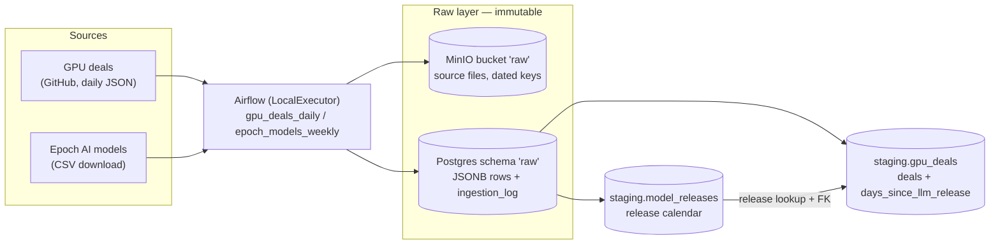

# GPU Affordability
DENG Module Group Project

GPU prices are rising rapidly, leaving many consumers uncertain about when to buy. The final product is a forecast that helps small businesses and individuals look past the hype: a daily-updated table ranking GPUs into **Buy Now** vs. **Wait**. At the midterm the repository delivers the raw layer, the AI model release calendar and the deal staging table; the Buy/Wait ranking is the W14 deliverable.

## Data

| Source | Access / format | Update | Volume | Main risks |
|---|---|---|---|---|
| GPU deals | [HardwareDealsCo/gpu-deals](https://github.com/HardwareDealsCo/gpu-deals): `current-gpu-deals.json` plus dated archive files; JSON array | daily | ~3.8k–4.5k listings/day; ~350 archived dates | upstream archive gaps, duplicate listings, changed price/VRAM formats, eBay listing churn |
| AI model releases | [Epoch AI notable models](https://epoch.ai/data/ai-models): direct CSV download (CC-BY, see attribution below) | semi-static | 1,078 records in the bundled snapshot; 1,079 live at time of writing | no historical versions upstream, possible schema/date-format changes |

Fields used from the GPU JSON: `title`, `brand`, `price`, `currency`, `condition`, `link`, `source`, `itemGroupType`, `chipset`, `vram_gb`. Epoch fields used: `Model`, `Organization`, `Publication date`.

## Architecture

**v0.2 — as implemented (local phase):**



Changed decisions vs. the [v0.1 pitch](images/architecture_v0.1.png):
- Local MinIO stands in for GCS (same S3 API — the cloud phase only changes the endpoint); BigQuery moves to W14.
- Airflow orchestrates from the local phase on, as LocalExecutor (no redis/worker needed).
- Epoch CSV comes from a stable download URL with a hash check — no scraping, no manual export.
- Transformation starts with two justified deliverables (release calendar and deal staging table); the buy/wait ranking stays in W14.

## Setup

Prerequisites: Docker with Compose, `uv`, and free ports `5432`, `8080`, `8085`, `9000` and `5001`. `.env` is gitignored; never commit it.

```bash
uv sync
cp .env-example .env
# Fill every empty value in .env. Required: POSTGRES_PASSWORD,
# MINIO_SECRET, PGADMIN_DEFAULT_EMAIL, PGADMIN_DEFAULT_PASSWORD, FERNET_KEY.
# Generate FERNET_KEY with:
python3 -c "import base64,os;print(base64.urlsafe_b64encode(os.urandom(32)).decode())"
docker compose up -d     # postgres, object storage, mlflow, pgadmin, airflow
```

`init-db.sql` runs only when the Postgres volume is first created. To reset a broken environment, use `docker compose down -v` (this deletes local data) and `docker compose up -d`. Airflow creates both DAGs paused; unpause them before triggering (see [Airflow](#airflow)).

## Running the pipelines

The first GPU load is a **full backfill** of the upstream archive; later runs are **incremental**, one date per daily run. Each snapshot lands as immutable bytes in MinIO (bucket `raw`) and as JSONB rows in Postgres (schema `raw`). Rerunning a date deletes and replaces only that date, so it never duplicates. Upstream 404 gaps are skipped and marked skipped in Airflow; network/HTTP failures surface and are retried by the DAGs (2 attempts, 5-minute delay). The raw layer is not cleaned — transformation is a separate step.

On the host (docker stack must be up):
```bash
uv run python -m src.ingestion.epoch_models fetch    # models CSV (skipped if unchanged)
uv run python -m src.ingestion.gpu_deals backfill    # all history from GitHub
uv run python -m src.ingestion.gpu_deals daily       # today's deals
```
Also available: `gpu_deals seed` (loads pre-downloaded files from `data/GPU/`) and
`docker compose --profile ingest run --rm ingestion src.ingestion.gpu_deals daily`
(same pipeline inside docker, no local Python needed). `data/GPU/` is gitignored; use `backfill` unless you downloaded those snapshots yourself.

## Transformation

**Why these transformations:** the Buy/Wait use case needs two things the raw JSONB cannot provide directly: a clean release calendar as a model feature, and a typed per-listing table with price-per-GB and the number of days since the latest model release.

Run the CLI in this order: `model_releases`, then `gpu_deals`. The GPU transform also builds the release calendar first, so the Airflow task is safe if `epoch_models_weekly` has not run yet.

   1. `staging.model_releases` (id, model_name, organization, release_date >= 2020, built_at), derived from `raw.epoch_models`. Casts the date, drops unparseable dates, deduplicates on (model_name, release_date), and upserts so IDs stay stable.
   2. `staging.gpu_deals` (typed listing fields, price_per_gb, scraped_at, model_release_id, days_since_llm_release), derived from `raw.gpu_deals`. Selects and renames fields, casts values, collapses exact duplicate listings, computes price per GB, and links each deal to the latest release on or before its snapshot date. The CLI `build` rebuilds all days; the daily DAG replaces one day.

**Grain:** one row per (`model_name`, `release_date`) in `staging.model_releases`; one row per distinct listing per snapshot date in `staging.gpu_deals`.

```bash
uv run python -m src.transformation.model_releases build
```

```bash
uv run python -m src.transformation.gpu_deals build
```

## Airflow

UI at http://localhost:8080 (login `airflow` / `airflow`). Both DAGs are **paused at creation**, so unpause them once before scheduled runs or manual triggers:

```bash
docker compose exec airflow-scheduler airflow dags unpause epoch_models_weekly
docker compose exec airflow-scheduler airflow dags unpause gpu_deals_daily
```

| DAG | Schedule | Does |
|---|---|---|
| `epoch_models_weekly` | Mon 07:00 UTC | hash-checked CSV refresh + release calendar rebuild |
| `gpu_deals_daily` | daily 06:00 UTC | one snapshot per logical date + row-count check + release-calendar rebuild + `staging.gpu_deals` transform |

```bash
# Ad-hoc run
docker compose exec airflow-scheduler airflow dags trigger epoch_models_weekly
docker compose exec airflow-scheduler airflow dags trigger gpu_deals_daily

# Full history (the Verify counts below assume this)
docker compose exec airflow-scheduler airflow backfill create \
  --dag-id gpu_deals_daily --from-date 2025-09-19 --to-date "$(date +%F)" \
  --max-active-runs 4

# Small backfill example
docker compose exec airflow-scheduler airflow backfill create \
  --dag-id gpu_deals_daily --from-date 2026-10-12 --to-date 2026-10-13
```

The archive lags the current date by a few days; missing dates are skipped, not failed.

## Verify

Run against the compose Postgres (use the user/database from your `.env`):

```bash
docker compose exec -T postgres psql -U sharedUser -d gpu <<'SQL'
SELECT count(*), count(DISTINCT snapshot_date) FROM raw.gpu_deals;
SELECT count(*) FROM staging.model_releases;
SELECT source, mode, status, rows_loaded FROM raw.ingestion_log ORDER BY id DESC LIMIT 10;
SELECT count(*), count(model_release_id) FROM staging.gpu_deals;
SQL
```

Expected after the **full backfill**:
- `raw.gpu_deals`: about 1.3M rows across 350+ available dates (the upstream archive currently has 352 dates; some gaps).
- `staging.model_releases`: at least 628 rows (628 from the bundled CSV, 629 from the live CSV at time of writing).
- `raw.ingestion_log`: `success` rows for both sources.
- `staging.gpu_deals`: both counts > 0; equal when every deal has a prior release (true for the 2025+ data).

A single daily run intentionally loads **one** date (~3.8k raw rows), so the 1.3M-row check only applies after the full backfill. Optional object-store check:

```bash
docker compose exec airflow-scheduler python -c \
  "from src.ingestion.storage import get_client; print(sorted(b['Name'] for b in get_client().list_buckets()['Buckets']))"
```

## Known limitations

- Epoch AI publishes only the current CSV, not historical versions. Backfilling `epoch_models_weekly` for an old logical date reloads today's CSV; use it only for the latest snapshot. The GPU archive is dated and can be backfilled.
- For today, `gpu_deals daily` falls back to `current-gpu-deals.json` until the dated archive file exists; a later backfill of that date can replace the snapshot with the archive version.
- `staging.gpu_deals` collapses exact duplicate listings within a snapshot (e.g. 3,805 raw rows → 2,349 staging rows on 2026-10-25). Bundle listings ("set of two cards") can skew `price_per_gb` because `vram_gb` is per card.
- Local Compose defaults (Airflow `airflow/airflow`, hardcoded Airflow metadata DB credentials) are for development only; cloud infrastructure, Terraform and secret management are W14 work.


## Servers

| Server | Inside docker network | From your laptop |
|---|---|---|
| Postgres | postgres:5432 | localhost:5432 |
| MinIO | objectstorage:9000 | localhost:9000 |
| pgAdmin | — | localhost:8085 |
| Airflow UI | — | localhost:8080 (login airflow/airflow) |
| MLflow | — | localhost:5001 |

pgAdmin connection: host `postgres`, port `5432`, user `sharedUser`, password from `.env`.

## Attribution

Epoch AI model data is licensed CC-BY — cite *Epoch AI, 'Data on AI Models', epoch.ai/data/ai-models*.

## Initial Plan

#### W7 Midterm
- Ingestion pipeline (4); local storage/schema (2); Docker/reproducible environment (3);
  ReadMe for Peer Reproducibility; Oral Defence (both team members).

Silas: local storage (s3), Docker environment, MLflow.
Natalie: ingestion.
Shared: reproducibility, README.

#### W14
- Terraform/cloud infrastructure (3); cloud ingestion (3); transformation and warehouse
  design (3); orchestration, reliability and data quality (2); documentation, security
  and reproducibility (2); Peer Review; Oral Defence.

Silas: transformation and warehouse design, cloud ingestion.
Natalie: Terraform/cloud infrastructure, orchestration, reliability and data quality.
Shared: documentation, security and reproducibility.

Optional: compare classification with a prognosis model predicting the next day.
