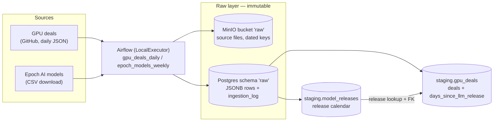

# GPU Affordability
DENG Module Group Project

GPU prices are rising rapidly, leaving many consumers uncertain about when to buy. This project provides a forecast to help small businesses and individuals look past the hype: a daily-updated table ranking GPUs into **Buy Now** vs. **Wait**.

## Data

- **GPU deals** — [HardwareDealsCo/gpu-deals](https://github.com/HardwareDealsCo/gpu-deals): daily JSON snapshots of eBay GPU listings (~4k listings/day).
- **AI model releases** — [Epoch AI notable models](https://epoch.ai/data/ai-models): CSV of major AI model releases (CC-BY, see attribution below), used as forecast features.

## Architecture

**v0.2 — as implemented (local phase):**



Changed decisions vs. the [v0.1 pitch](images/architecture_v0.1.png):
- Local MinIO stands in for GCS (same S3 API — the cloud phase only changes the endpoint); BigQuery moves to W14.
- Airflow orchestrates from the local phase on, as LocalExecutor (no redis/worker needed).
- Epoch CSV comes from a stable download URL with a hash check — no scraping, no manual export.
- Transformation starts with one justified deliverable (release calendar); the buy/wait curation stays in W14.

## Setup


```bash
uv sync                  # python deps
cp .env-example .env     # fill in; FERNET_KEY via:
                         #   python3 -c "import base64,os;print(base64.urlsafe_b64encode(os.urandom(32)).decode())"
                         # Set all users and passwords
docker compose up -d     # postgres, minio, mlflow, pgadmin, airflow
# To complete the setup choose one path: CLI (Running the pipelines + Transformation) or Airflow.
```

## Running the pipelines

Sources land as immutable files in MinIO (bucket `raw`) and as JSONB rows in the Postgres `raw` schema. Every load is idempotent (re-running a snapshot replaces it, never duplicates) and logged in `raw.ingestion_log`. No cleaning happens here — transformation is its own step below.

On the host (docker stack must be up):
```bash
uv run python -m src.ingestion.epoch_models fetch    # models CSV (skipped if unchanged)
uv run python -m src.ingestion.gpu_deals backfill    # all history from GitHub
uv run python -m src.ingestion.gpu_deals daily       # today's deals
```
Also available: `gpu_deals seed` (loads pre-downloaded files from `data/GPU/`) and
`docker compose --profile ingest run --rm ingestion src.ingestion.gpu_deals daily`
(same pipeline inside docker, no local Python needed).

## Transformation 

Run in this order: model_releases, then gpu_deals.

   1. `staging.model_releases` (id, model_name, organization, release_date >= 2020, built_at),
      derived from `raw.epoch_models`. Upserts on (model_name, release_date), so IDs stay stable.
   2. `staging.gpu_deals` (...), derived from `raw.gpu_deals`. Each deal links to the latest
      release on or before its scrape date. The CLI `build` rebuilds all days; the daily DAG replaces one day.

```bash
uv run python -m src.transformation.model_releases build
```

```bash
uv run python -m src.transformation.gpu_deals build
```

## Airflow

Or via Airflow — UI at http://localhost:8080 (login `airflow` / `airflow`):

| DAG | Schedule | Does |
|---|---|---|
| `epoch_models_weekly` | Mon 07:00 UTC | hash-checked CSV refresh + release calendar rebuild |
| `gpu_deals_daily` | daily 06:00 UTC | one snapshot per logical date + row-count check + `staging.gpu_deals` transform |

```bash
docker compose exec airflow-scheduler airflow dags trigger epoch_models_weekly 
docker compose exec airflow-scheduler airflow dags trigger gpu_deals_daily   # ad-hoc run
docker compose exec airflow-scheduler airflow backfill create \
  --dag-id gpu_deals_daily --from-date 2026-10-12 --to-date 2026-10-13       # backfill
```


## Verify

```sql
SELECT count(*), count(DISTINCT snapshot_date) FROM raw.gpu_deals;  -- > 1.35M rows, 345 days 
SELECT count(*) FROM staging.model_releases;                        -- > 628 rows 
SELECT source, mode, status, rows_loaded FROM raw.ingestion_log;
SELECT count(*), count(model_release_id) FROM staging.gpu_deals;  -- both > 0; equal unless deals predate the first release
```


## Servers

| Server | Inside docker network | From your laptop |
|---|---|---|
| Postgres | postgres:5432 | localhost:5432 |
| MinIO | objectstorage:9000 | localhost:9000 |
| pgAdmin | — | localhost:8085 |
| Airflow UI | — | localhost:8080 (login airflow/airflow) |
| MLflow | — | localhost:5001 |

pgAdmin connection: host `postgres`, port `5432`, user `sharedUser`, password from `.env`.

## Attribution

Epoch AI model data is licensed CC-BY — cite *Epoch AI, 'Data on AI Models', epoch.ai/data/ai-models*.

## Initial Plan

#### W7 Midterm
- Ingestion pipeline (4); local storage/schema (2); Docker/reproducible environment (3);
  ReadMe for Peer Reproducibility; Oral Defence (both team members).

Silas: local storage (s3), Docker environment, MLflow.
Natalie: ingestion.
Shared: reproducibility, README.

#### W14
- Terraform/cloud infrastructure (3); cloud ingestion (3); transformation and warehouse
  design (3); orchestration, reliability and data quality (2); documentation, security
  and reproducibility (2); Peer Review; Oral Defence.

Silas: transformation and warehouse design, cloud ingestion.
Natalie: Terraform/cloud infrastructure, orchestration, reliability and data quality.
Shared: documentation, security and reproducibility.

Optional: compare classification with a prognosis model predicting the next day.
