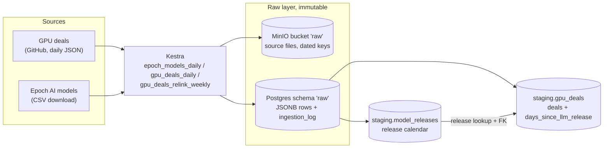

# GPU Affordability
DENG Module Group Project

GPU prices keep rising, and buyers can't tell when to buy. We build a forecast for small businesses and individuals: a table, updated daily, that ranks GPUs into **Buy Now** or **Wait**. At the midterm the repository delivers the raw layer, the AI model release calendar and the deal staging table. The Buy/Wait ranking is the W14 deliverable.

## Data

| Source | Access / format | Update | Volume | Main risks |
|---|---|---|---|---|
| GPU deals | [HardwareDealsCo/gpu-deals](https://github.com/HardwareDealsCo/gpu-deals): `current-gpu-deals.json` plus dated archive files; JSON array | daily | ~3.8k–4.5k listings/day; ~350 archived dates | upstream archive gaps, duplicate listings, changed price/VRAM formats, eBay listing churn |
| AI model releases | [Epoch AI notable models](https://epoch.ai/data/ai-models): direct CSV download (CC-BY, see attribution below) | semi-static | 1,078 records in the bundled snapshot; 1,079 live at time of writing | no historical versions upstream, possible schema/date-format changes |

Fields used from the GPU JSON: `title`, `brand`, `price`, `currency`, `condition`, `link`, `source`, `itemGroupType`, `chipset`, `vram_gb`. Epoch fields used: `Model`, `Organization`, `Publication date`.

## Architecture

**v0.2, as implemented (local phase):**



Changed decisions vs. the [v0.1 pitch](images/architecture_v0.1.png):
- Local MinIO stands in for GCS. It speaks the same S3 API, so the cloud phase only changes the endpoint. BigQuery moves to W14.
- Kestra orchestrates the pipelines from the local phase on. Each flow task calls one CLI command from `src/`.
- The Epoch CSV comes from a stable download URL with a hash check. We don't scrape or export it by hand.
- Transformation starts with two deliverables, the release calendar and the deal staging table. The Buy/Wait ranking stays in W14.

## Setup

Prerequisites: Docker with Compose, `uv`, and free ports `5432`, `5001`, `8081`, `8085` and `9000`. Git ignores `.env`; keep it out of commits.

```bash
uv sync
cp .env-example .env
# Fill every empty value in .env. Compose refuses to start without
# POSTGRES_PASSWORD, POSTGRES_DB, POSTGRES_USER, KESTRA_USER and KESTRA_PASSWORD.
# Also set MINIO_SECRET, PGADMIN_DEFAULT_EMAIL and PGADMIN_DEFAULT_PASSWORD.
docker compose up -d     # postgres, object storage, mlflow, pgadmin, kestra
```

Postgres runs `containers/postgres/init-db.sql` only when it first creates the volume. To reset a broken environment, run `docker compose down -v` (this deletes all local data), then `docker compose up -d`.

## Running the pipelines

The first GPU load is a **full backfill** of the upstream archive. Later runs are **incremental** and load one date each. Each snapshot lands as untouched bytes in MinIO (bucket `raw`) and as JSONB rows in Postgres (schema `raw`). Rerunning a date deletes and replaces that date only, so you never get duplicates. The CLI logs an upstream 404 as a skipped date and exits 0. Network and HTTP errors exit non-zero, and Kestra retries the task (3 attempts, 5 minutes apart). Ingestion doesn't clean the raw layer; the transformation step does.

On the host (the docker stack must be up):
```bash
uv run python -m src.ingestion.epoch_models fetch                  # models CSV, skipped if unchanged
uv run python -m src.ingestion.gpu_deals backfill                  # all history from GitHub
uv run python -m src.ingestion.gpu_deals daily --date 2026-10-20   # one past day
uv run python -m src.ingestion.gpu_deals daily                     # today's deals
uv run python -m src.ingestion.gpu_deals verify                    # fail if today has < 1000 raw rows
```

| Command | Flags | Does |
|---|---|---|
| `epoch_models fetch` | `--date` (default today) | downloads the CSV and loads it if the sha256 changed |
| `gpu_deals daily` | `--date` (default today) | loads one snapshot. Past dates log as mode `backfill`. An upstream gap logs a warning and exits 0. |
| `gpu_deals verify` | `--date`, `--min-rows` (default 1000, env `MIN_EXPECTED_ROWS`) | fails with `TooFewRowsError` if the day has fewer raw rows |
| `gpu_deals backfill` | `--start` (default 2025-09-19), `--end` (default today), `--force` | loads every missing date in the range; `--force` reloads dates already loaded |
| `gpu_deals seed` | `--limit` | loads pre-downloaded files from `data/GPU/` |

Each command also runs inside docker, without local Python:
`docker compose --profile ingest run --rm ingestion src.ingestion.gpu_deals daily`.
Git ignores `data/GPU/`, so use `backfill` unless you downloaded those snapshots yourself.

## Transformation

The Buy/Wait use case needs two things the raw JSONB can't give it: a clean release calendar as a model feature, and a typed per-listing table with price per GB and the days since the latest model release.

Run `model_releases` first, then `gpu_deals`. `gpu_deals build` rebuilds the release calendar itself, so you can skip the first step, but `raw.epoch_models` needs at least one load.

1. `staging.model_releases` (id, model_name, organization, release_date >= 2020, built_at) comes from `raw.epoch_models`. The build casts the date, drops dates it can't parse, deduplicates on (model_name, release_date) and upserts, so IDs stay stable.
2. `staging.gpu_deals` (typed listing fields, price_per_gb, scraped_at, model_release_id, days_since_llm_release) comes from `raw.gpu_deals`. The build selects and renames fields, casts values, collapses exact duplicate listings, computes price per GB and links each deal to the latest release on or before its snapshot date. `build` rebuilds all days; `build --date` replaces one day.

**Grain:** one row per (`model_name`, `release_date`) in `staging.model_releases`; one row per distinct listing per snapshot date in `staging.gpu_deals`.

```bash
uv run python -m src.transformation.model_releases build
uv run python -m src.transformation.gpu_deals build                    # full history
uv run python -m src.transformation.gpu_deals build --date 2026-10-20  # one day
```

`gpu_deals build` raises `TooFewRowsError` when fewer than `--min-rows` rows come out (default 1000, env `MIN_EXPECTED_ROWS`; `--min-rows 0` turns the check off). It checks before the commit, so a failed build leaves `staging.gpu_deals` as it was.

## Kestra

Kestra runs the pipelines on a schedule. Open the UI at [http://localhost:8081](http://localhost:8081) (`KESTRA_PORT`) and log in with `KESTRA_USER` and `KESTRA_PASSWORD` from `.env`. Kestra reads the flows from `containers/kestra/flows/` into the namespace `gpu` and picks up file edits while it runs.

Each task starts a container from the `gpu-ingestion:local` image. Kestra won't pull it, so build it once before the first run:

```bash
docker compose --profile ingest build ingestion
```

| Flow | Schedule (UTC) | Does |
|---|---|---|
| `epoch_models_daily` | daily, 05:00 | fetches the Epoch CSV and rebuilds `staging.model_releases` |
| `gpu_deals_daily` | daily, 06:00 | loads the day's snapshot, checks it has at least 1,000 rows, and transforms that day into `staging.gpu_deals` |
| `gpu_deals_relink_weekly` | Sunday, 08:00 | rebuilds all of `staging.gpu_deals`, so older deals link to releases Epoch added after their load |

`epoch_models_daily` must finish before `gpu_deals_daily` starts, because the deal transform links each listing to a release in the calendar. The schedules leave one hour between the two. On a fresh setup, execute `epoch_models_daily` by hand first, then `gpu_deals_daily` with `backfill` on. Full rebuilds of `staging.gpu_deals` have a one-hour timeout. Each flow queues a second execution until the first one ends. If Kestra was down at a scheduled time, it runs the last missed execution when it starts again.

To run `gpu_deals_daily` by hand, open the flow in the UI and click **Execute**. The inputs pick the mode:

| Inputs | Loads | Transforms |
|---|---|---|
| none | today | that day, after the 1,000-row check |
| `date` | that day | that day, after the 1,000-row check |
| `date` + `end_date` | every missing date in the span, inclusive | full rebuild |
| `backfill` | every missing date since 2025-09-19; ignores `date` and `end_date` | full rebuild |
| `force` | with a span or `backfill`: also reloads dates already in `raw.gpu_deals` | full rebuild |

A span or backfill skips upstream gaps and has no per-day check; the `--min-rows` check of the full rebuild guards staging instead. A single-day run replaces its date anyway, so it ignores `force`.

## Verify

Run these queries against the compose Postgres (use the user and database from your `.env`):

```bash
docker compose exec -T postgres psql -U sharedUser -d gpu <<'SQL'
SELECT count(*), count(DISTINCT snapshot_date) FROM raw.gpu_deals;
SELECT count(*) FROM staging.model_releases;
SELECT source, mode, status, rows_loaded FROM raw.ingestion_log ORDER BY id DESC LIMIT 10;
SELECT count(*), count(model_release_id) FROM staging.gpu_deals;
SQL
```

Expected after the **full backfill**:
- `raw.gpu_deals`: about 1.3M rows across 350+ dates (the upstream archive has 352 dates at time of writing, with gaps).
- `staging.model_releases`: at least 628 rows (628 from the bundled CSV, 629 from the live CSV at time of writing).
- `raw.ingestion_log`: `success` rows for both sources.
- `staging.gpu_deals`: both counts > 0. They match when every deal has a prior release, which holds for the 2025+ data.

A single daily run loads **one** date (~3.8k raw rows), so the 1.3M-row check applies only after the full backfill. To check the object store from the host:

```bash
uv run python -c "from src.ingestion.storage import get_client; print(sorted(b['Name'] for b in get_client().list_buckets()['Buckets']))"
```

## Known limitations

- Epoch AI publishes only the current CSV, with no history. `epoch_models fetch --date` with an old date downloads today's CSV and stores it under that date, so use it for the latest snapshot only. The GPU archive is dated, and you can backfill it.
- For today, `gpu_deals daily` falls back to `current-gpu-deals.json` until the dated archive file exists. A later `daily --date` or `backfill --force` for that date replaces the snapshot with the archive version.
- `staging.gpu_deals` collapses exact duplicate listings within a snapshot (on 2026-10-25, 3,805 raw rows became 2,349 staging rows). Bundle listings ("set of two cards") skew `price_per_gb`, because `vram_gb` counts one card.
- The Compose setup targets local development. Cloud infrastructure, Terraform and secret management are W14 work.

## Servers

| Server | Inside docker network | From your laptop |
|---|---|---|
| Postgres | postgres:5432 | localhost:5432 |
| MinIO | objectstorage:9000 | localhost:9000 |
| pgAdmin | pgadmin:80 | localhost:8085 (`PGADMIN_PORT`) |
| Kestra UI | kestra:8080 | localhost:8081 (`KESTRA_PORT`, login from `.env`) |
| MLflow | mlflow:5001 | localhost:5001 |

pgAdmin connection: host `postgres`, port `5432`, user `sharedUser`, password from `.env`.

## Attribution

Epoch AI licenses the model data as CC-BY. Cite *Epoch AI, 'Data on AI Models', epoch.ai/data/ai-models*.

## Initial Plan

#### W7 Midterm
- Ingestion pipeline (4); local storage/schema (2); Docker/reproducible environment (3);
  ReadMe for Peer Reproducibility; Oral Defence (both team members).

Silas: local storage (s3), Docker environment, MLflow.
Natalie: ingestion.
Shared: reproducibility, README.

#### W14
- Terraform/cloud infrastructure (3); cloud ingestion (3); transformation and warehouse
  design (3); orchestration, reliability and data quality (2); documentation, security
  and reproducibility (2); Peer Review; Oral Defence.

Silas: transformation and warehouse design, cloud ingestion.
Natalie: Terraform/cloud infrastructure, orchestration, reliability and data quality.
Shared: documentation, security and reproducibility.

Optional: compare classification with a prognosis model predicting the next day.
