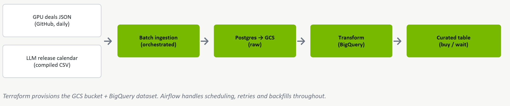

# GPU Affordability
DENG Module Group Project

GPU prices are rising rapidly, leaving many consumers uncertain about when to buy their preferred hardware. This issue is compounded by constant news coverage and frequent releases of new Large Language Models (LLMs).


## Use Case

This project provides a forecast to help small businesses and individuals look past the hype. It helps determine whether an intended GPU can be purchased at a reasonable price now, or if waiting is the better option.

To achieve this, the project maintains a daily-updated table ranking GPUs into two categories: **Buy Now** vs. **Wait**.


## Data

- **Historical Hardware Deals:** A dataset tracking hardware deals since last year.
  - **Source:** [HardwareDealsCo/gpu-deals](https://github.com/HardwareDealsCo/gpu-deals)
  - **Details:** The source scrapes deal data from the website HardwareDeals.co, which compiles hardware listings from eBay.

- **AI Release Milestones:** An additional dataset collecting major AI model releases and company announcements.
  - **Details:** Gathered manually (or via scraping where feasible) to enhance the model's forecasting performance.


## Architecture



## Ingestion Pipeline (W7)

Scope: **extract both sources → land immutable raw copies in MinIO → load
queryable JSONB rows in Postgres `raw` schema**. No cleaning, typing,
deduplication or aggregation happens here — that is the W14 transformation
phase. Every run is logged in `raw.ingestion_log` and is idempotent
(re-running a snapshot replaces it, never duplicates).

### Where the data lands

| Layer | Location |
|---|---|
| Raw files | MinIO bucket `raw`: `gpu-deals/date=YYYY-MM-DD/GPU-YYYY-MM-DD.json`, `epoch-ai/load_date=YYYY-MM-DD/notable_models.csv` |
| Raw tables | `raw.gpu_deals` (one JSONB row per listing per day), `raw.epoch_models` (one JSONB row per model) |
| Audit | `raw.ingestion_log` (source, mode, snapshot_date, status, rows, message) |

### Run it

On the host (needs the docker stack up):
```bash
uv run python -m src.ingestion.gpu_deals seed       # one-time: 330 local files
uv run python -m src.ingestion.gpu_deals backfill   # fill gaps from GitHub archive
uv run python -m src.ingestion.gpu_deals daily      # today's deals
uv run python -m src.ingestion.epoch_models snapshot  # Epoch AI CSV
```

Or inside docker (same commands work, no local Python needed):
```bash
docker compose --profile ingest run --rm ingestion src.ingestion.gpu_deals daily
```

### Verify

```sql
SELECT count(*), count(DISTINCT snapshot_date) FROM raw.gpu_deals;  -- 1.35M rows, 345 days
SELECT source, mode, status, rows_loaded FROM raw.ingestion_log;
```


## UV Environment

UV is generous on both Windows and Mac devices, which makes it more generous for a group project.

```
uv init

# On every update.
uv sync

# Add a new library to the project.
uv add {library}

# Run python scripts
uv run {script}
```


## Docker Containers

Build docker containers
```
docker compose up -d

# When finished
docker compose down
```

#### Servers
| Server | Inside docker network | From your laptop (host) |
|---|---|---|
| PostgresSQL | postgres:5432 | localhost:5432 |
| PGAdmin | — | localhost:8085 |
| Minio Objectstore | objectstorage:9000 | localhost:9000 |
| MLFlow | — | localhost:5001 |
| development | VS Code, servers are accessible. With above links. | |

#### Login PGAdmin

Server needs to be loaded manually, if interaction with PostgresSQL DB is required.

| Connection | Address used |
|---|---|
| Your laptop's browser → pgAdmin | `http://localhost:8085` | 
| pgAdmin container → PostgreSQL container | Host `postgres`, port `5432`, user `sharedUser`, pw `in .env` | 


### Initial Plan

#### W3 Pitch + Initial Project Setup
- Data source

#### W7 Midterm
- Ingestion pipeline (4); 
- local storage/schema (2); 
- Docker/reproducible environment (3); 
- ReadMe with instructions required for Peer Reproducibility
- Proper Review
- Oral Defence (Understand entire codebase and decisions. Both team members.)

Silas:
- Local Storage 
  - s3
- Docker environment
  - Python script app for ingestion
  - s3 volume
  - MLFlow

Natalie:
- Ingestion

Shared:
- Reproducibility
- ReadMe


#### W14
- Terraform/cloud infrastructure (3); 
- cloud ingestion (3); 
- transformation and warehouse design (3); 
- orchestration, reliability and data quality (2); 
- documentation, security and reproducibility (2):
- Peer Review
- Oral Defence (Understand entire codebase and decisions. Both team members.)

Silas:
- transformation and warehouse design
- cloud ingestion


Natalie:
- Terraform/cloud infrastructure
- orchestration, reliability and data quality

Shared:
- documentation, security and reproducibility

Optional: Compare classification with prognosis model with prediction for next day. 